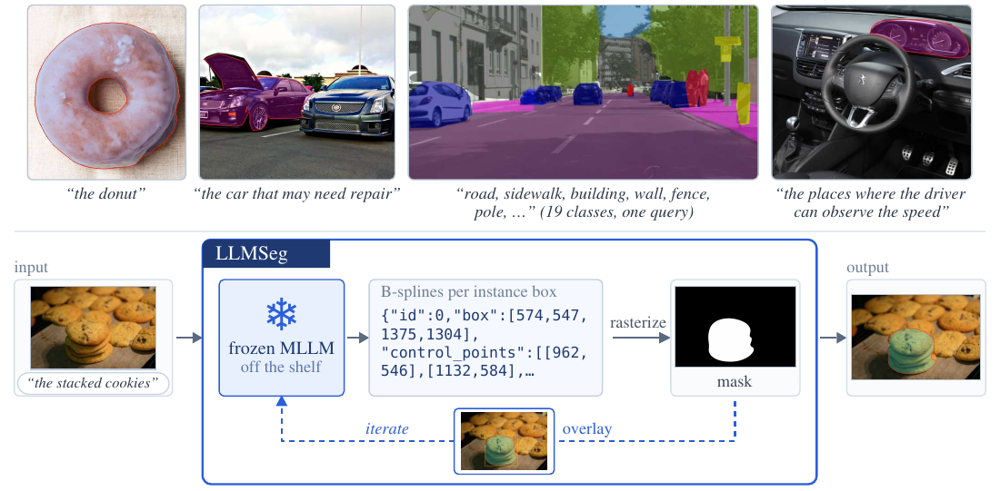
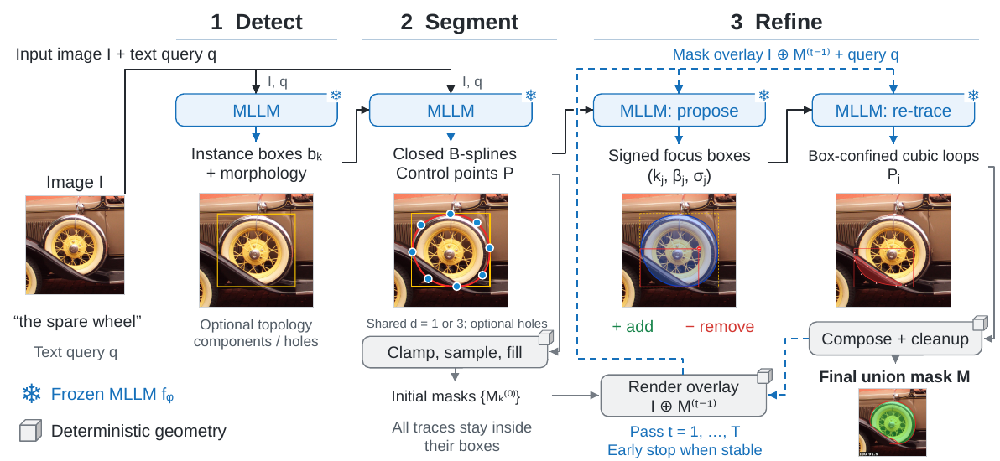

<div align="center">

# LLMSeg: Training-Free Text-Prompted Image Segmentation with B-Splines

**Abdullah Hamdi**

King Abdullah University of Science and Technology (KAUST)

[](#citation)
[](#installation)
[](#api-keys-and-providers)



</div>

LLMSeg turns an off-the-shelf multimodal LLM into a text-prompted image segmenter, **with no
training, no segmentation head and no mask decoder**. The model is only ever asked for
coordinates (boxes and B-spline control points) as JSON; everything else (parsing, box
confinement, rasterization, mask composition, stopping) is deterministic code.

With Gemini-3.7-Flash as the backend, LLMSeg is competitive with, and often surpasses, the
specialist SAM 3 model on identical items across eleven benchmarks, reaching **71.5 cIoU on
ReasonSeg val**. Swapping in a newer backend model improves accuracy without retraining anything.

This repository contains the full method, the 16 toy images used during development, and the
complete evaluation harness for every benchmark in the paper. Every component runs with an API key
from **any one** of Google Gemini, Anthropic, OpenAI or OpenRouter.

---

## Contents

- [How it works](#how-it-works)
- [Installation](#installation)
- [API keys and providers](#api-keys-and-providers)
- [Quick start: segment an image](#quick-start-segment-an-image)
- [Toy examples](#toy-examples)
- [Evaluation](#evaluation)
  - [Downloading the benchmarks](#1-download-the-benchmarks)
  - [Running the harnesses](#2-run-the-harnesses)
  - [Metrics and outputs](#3-metrics-and-outputs)
  - [Reproducing the paper](#4-reproduce-the-paper)
- [Main results](#main-results)
- [Repository layout](#repository-layout)
- [Citation](#citation)

---

## How it works



```
stage 1  detect   image + text query      -> N instance boxes (+ short morphology)
stage 2  segment  image + instance boxes  -> closed B-splines per instance -> mask
stage 3  refine   overlay of current mask -> signed focus boxes (+ add / - remove)
                                          -> B-splines per focus box -> composed mask
                  repeated for up to T passes; stops early once the mask stops moving
```

* **Box confinement.** Every control point and every sampled curve point is clamped to its box
  (the instance box in stage 2, the focus box in stage 3) before rasterization, so a mask can never
  leave its instance box.
* **Closed periodic B-splines.** Each outline is an outer loop (plus optional hole loops) that is
  sampled and filled into a binary mask; per-instance masks are united into the final mask.
* **Soft-lock composition.** Each instance carries a signed commitment field next to its mask, so
  successive refinement passes cannot simply undo each other.
* **Bounded cost.** One call each for stages 1 and 2, at most two per refinement pass (focus boxes,
  then one batched call for all their B-splines): at most 2T + 2 = 18 calls per image with the
  default T = 8, usually far fewer because of early stopping.

## Installation

Python 3.10 or newer.

```bash
git clone https://github.com/ajhamdi/llmseg-code.git
cd llmseg-code

pip install -r requirements.txt          # pipeline + toy examples
pip install -r requirements-evals.txt    # + evaluation harness and dataset downloads
```

Or with [uv](https://docs.astral.sh/uv/): `uv sync` (pipeline) or `uv sync --extra evals` (everything),
then prefix commands with `uv run`.

## API keys and providers

You need **one** key. Put it in a `.env` file (copy `.env.example`) or export it:

| provider | environment variable | example `--model` |
|---|---|---|
| Google Gemini API | `GEMINI_API_KEY` (or `GOOGLE_API_KEY`) | `gemini-3.7-flash` (paper), `gemma-4-31b-it` |
| OpenRouter | `OPENROUTER_API_KEY` | `google/gemini-3.7-flash`, `qwen/qwen3-vl-235b-a22b-instruct` |
| Anthropic | `ANTHROPIC_API_KEY` | `claude-sonnet-5-5`, `claude-opus-5-5` |
| OpenAI | `OPENAI_API_KEY` | `gpt-5.6-terra` |

The provider is inferred from the model name: a slug containing `/` goes to OpenRouter,
`gemini-*` / `gemma-*` to the Gemini API, `claude-*` to Anthropic, `gpt-*` / `o<digit>*` to OpenAI.
Force it with `--provider {gemini,anthropic,openai,openrouter}`. If you omit `--model`, the first
provider with a key set (in the order Gemini, OpenRouter, OpenAI, Anthropic) is used with the default
model from the table.

Prompts, parsers and geometry are identical for every provider. What differs is handled per model
family in `llm.py`: Gemini, Gemma and Qwen-VL answer on their native 0-1000 grid (Gemini and Gemma with
their native `box_2d = [ymin, xmin, ymax, xmax]` layout), every other model answers in pixels, and
all replies are converted to absolute pixels before any other code sees them.

## Quick start: segment an image

```bash
python pipeline.py data/toy/cat.jpg "the cat" --out-dir output/cat
python pipeline.py data/toy/taxis.jpeg "the taxi" --model gemini-3.7-flash
python pipeline.py data/toy/dog.jpeg "the dog" --model claude-sonnet-5-5
python pipeline.py data/toy/car.jpg "the car" --model gpt-5.6-terra
python pipeline.py data/toy/clock.jpeg "the clock" --model google/gemini-3.7-flash   # OpenRouter
```

| option | default | meaning |
|---|---|---|
| `--model` | see above | vision model; the provider is inferred from it |
| `--provider` | `auto` | force a provider |
| `--iterations` | `8` | refinement budget T; `0` stops after stage 2 ("w/o refine") |
| `--max-instances` | `200` | instances kept per image (highest confidence first) |
| `--timeout` | `400` | seconds per vision call |
| `--topology` | off | topology conditioning (see [design switches](#design-switches)) |
| `--refine-box` | off | detect-box adjustment pre-pass, +1 call |
| `--no-postprocess` | off | skip the per-pass morphological cleanup |
| `--out-dir` | `output/<image stem>` | where records and images are written |

<a id="design-switches"></a>
**Design switches.** The defaults are the paper's main-results configuration. Together with
`--iterations`, three switches select the design alternatives studied in the paper's ablations:

* `--topology`: stage 1 also reports each instance's topology (connected components, holes),
  stage 2 fits one loop per component and one per hole, and the per-pass cleanup fills small holes
  only when topology reports none and drops specks only when it reports one component. The
  ablation study's reference configuration is `--topology --iterations 12`; the main results leave
  topology off.
* `--refine-box`: before the first refinement pass, one call shifts each instance box by signed
  per-side deltas (capped at 20% of the box width / height); all later refinement is confined to
  the adjusted box. Adds one call, so the call bound becomes 2T + 3.
* `--no-postprocess`: compose each pass's refinements without the deterministic closing /
  opening / hole and speck cleanup.

```bash
python pipeline.py data/toy/donut.jpeg "the donut" --topology --iterations 12   # ablation reference
python pipeline.py data/toy/taxis.jpeg "the taxi" --refine-box --no-postprocess
```

The switches in effect are stored under `config` in `detect.json`, `seg.json` and `recseg.json`.

Outputs in `--out-dir`:

| file | content |
|---|---|
| `detect.json` | stage 1: instance boxes (pixels, `[x1, y1, x2, y2]`), labels, confidences, morphology |
| `seg.json`, `seg.png`, `seg_mask.png` | stage 2: per-instance B-splines, overlay, binary mask |
| `seg_box.png` | with `--refine-box`, when a box moved: the stage-2 overlay with the adjusted boxes (critiqued in pass 1) |
| `recseg_iter<k>.png`, `recseg_iter<k>_post.png` | overlay after pass k (the `_post` image is what the model critiques in pass k + 1; absent with `--no-postprocess`) |
| `recseg.json`, `recseg.png`, `rec_mask.png` | stage 3: every pass's refinements and residual, final overlay, **final binary mask** |
| `instances.json` | per instance: label, confidence, box, stage-2 and final mask (COCO RLE) |

Model replies are stochastic, so repeated runs differ slightly.

## Toy examples

The 16 development images (one query each) are in `data/toy/`:

```bash
./run_toy.sh                               # default model of the first provider with a key
./run_toy.sh gemini-3.7-flash              # Gemini API
./run_toy.sh google/gemini-3.7-flash       # OpenRouter
./run_toy.sh claude-sonnet-5-5             # Anthropic
./run_toy.sh gpt-5.6-terra                 # OpenAI
ITERATIONS=0 ./run_toy.sh                  # stage 2 only
./run_toy.sh gemini-3.7-flash --topology   # further arguments go to pipeline.py
```

Results land in `output/toy/<model>/<image>/` (final mask `rec_mask.png`, log `run.log`).

To check the geometry without any model call:

```bash
python -c "
import numpy as np
from geometry import mask_from_splines
th = np.linspace(0, 2 * np.pi, 12, endpoint=False)
ctrl = np.column_stack([100 + 60 * np.cos(th), 100 + 60 * np.sin(th)])
m = mask_from_splines([{'role': 'outer', 'degree': 3, 'control_points': ctrl.tolist()}],
                      [0, 0, 200, 200], (200, 200))
print('coverage %', round(m.mean() * 100, 1))"

python -m pytest tests/      # offline tests: routing, coordinates, metrics, a full scripted pipeline run
```

## Evaluation

The harness in `evals/` runs the released `pipeline.py` on every item of a benchmark, scores the
stage-2 mask (`seg_*` metrics, before refinement) and the final mask (`rec_*`, after refinement), and
reports each benchmark's standard metric. It works with every provider above (`--model` /
`--provider` as for the pipeline).

### 1. Download the benchmarks

Everything goes to `data/benchmarks/` (override with `LLMSEG_DATA=/path`). Only evaluation splits
are downloaded. All scripts are resumable.

| benchmark | what to run | needs | size |
|---|---|---|---|
| ReasonSeg val / test | `bash scripts/download_benchmarks.sh reasonseg` | | 1.5 GB |
| RefCOCO / RefCOCO+ / RefCOCOg | `bash scripts/download_benchmarks.sh refcoco`<br>`bash scripts/download_coco_images.sh train2014` | | 13 GB |
| SA-Co/Gold | `bash scripts/download_benchmarks.sh saco`<br>`python scripts/download_saco_images.py gold` | `HF_TOKEN` (accept the [facebook/SACo-Gold](https://huggingface.co/datasets/facebook/SACo-Gold) terms), `ROBOFLOW_API_KEY`, `pip install roboflow` | 3 GB |
| LVIS v1 val | `bash scripts/download_benchmarks.sh lvis`<br>`bash scripts/download_coco_images.sh lvis` | | 3.5 GB |
| COCO val2017 | `bash scripts/download_benchmarks.sh coco`<br>`bash scripts/download_coco_images.sh val2017` | | 0.8 GB |
| ADE20K val | `bash scripts/download_benchmarks.sh ade20k` | | 0.9 GB |
| Cityscapes val | `bash scripts/download_cityscapes.sh` | free [Cityscapes](https://www.cityscapes-dataset.com) account | 12 GB zips |
| ODinW13 | `python scripts/download_odinw.py` | | 0.5 GB |
| RF-100VL | `python scripts/download_rf100vl.py` | `ROBOFLOW_API_KEY`, `pip install rf100vl` | 41 GB |

Resulting layout:

```
data/benchmarks/
├── reasonseg/{val,test}/data/*.parquet           # images + masks inside the parquet
├── refcoco/{refcoco,refcocoplus,refcocog}/data/*.parquet
├── coco/annotations/instances_val2017.json
├── coco/images/{train2014,val2017,train2017}/    # train2017: only the LVIS-referenced subset
├── lvis/lvis_v1_val.json
├── saco/gold/*.json + saco/gold/images/
├── ade20k/ADEChallengeData2016/{images,annotations}/validation/
├── cityscapes/{leftImg8bit,gtFine}/val/
├── odinw/<subset>/{annotations.coco.json,images/}
└── rf100vl/<subset>/test/{_annotations.coco.json,*.jpg}
```

Respect each dataset's license; none of them is redistributed here.

### 2. Run the harnesses

Every harness first accepts `--dry-run`, which loads the items and scores the ground truth against
itself without any model call. Use it to check a download:

```bash
python evals/run_reasonseg.py --dry-run --n 5
```

| benchmark | command (one paper configuration each) |
|---|---|
| ReasonSeg | `python evals/run_reasonseg.py --split val` (and `--split test`) |
| RefCOCO/+/g | `python evals/run_refcoco.py --dataset refcoco --split testA --n 500 --shuffle` |
| SA-Co/Gold | `python evals/run_saco.py --split gold --domain all --n 2500 --shuffle` |
| LVIS / COCO | `python evals/run_instseg.py --dataset lvis --negatives 3 --n 1500 --shuffle`<br>`python evals/score_ap.py --dataset lvis --results <run dir>` |
| ADE20K | `python evals/run_ade20k.py --n 1000 --shuffle` |
| Cityscapes | `python evals/run_semseg.py` |
| ODinW13 / RF-100VL | `python evals/run_apzero.py --collection odinw`<br>`python evals/score_apzero.py --collection odinw --model <model>` |
| any COCO json | `python evals/run_cocodet.py --ann <json> --images <dir> --name <name>` |

Options shared by every harness:

| option | default | meaning |
|---|---|---|
| `--model`, `--provider` | as for `pipeline.py` | vision backend |
| `--iterations` | `8` | refinement budget T (`0` = stage 2 only) |
| `--topology`, `--refine-box`, `--no-postprocess` | off | forwarded to `pipeline.py` ([design switches](#design-switches)) |
| `--n` | `0` (all) | number of items |
| `--shuffle`, `--seed` | off, `0` | seeded shuffle before taking `--n` (the paper's sampled subsets) |
| `--parallel` | `1` | items in flight (mind your provider's rate limits) |
| `--timeout` | `400` | seconds per vision call |
| `--save` | `200` | keep overlays / masks for the first N items, JSON only afterwards |
| `--force` | off | ignore the checkpoint and redo everything |
| `--out` | `results/<benchmark>/<model>/<split>[__<config>]` | output directory |

Runs are **checkpointed per item**: re-running the same command resumes. A larger `--n` extends the
same run. A non-default `--iterations`, `--shuffle`, `--negatives` or design switch gets its own
directory (e.g. `val__it12__topo`), so two
configurations never mix. A run stops cleanly (without caching the item) on a billing, auth or daily
quota error; fix the account and re-run to resume. Pipeline failures are recorded and scored on
whatever mask they produced (usually empty).

To compare two runs (two models, two providers, two settings) on exactly their shared items:

```bash
python evals/compare_subset.py --a results/reasonseg/gemini-3.7-flash/val \
                               --b results/reasonseg/claude-sonnet-5-5/val
```

### 3. Metrics and outputs

| benchmark | metric (as in the paper) | where |
|---|---|---|
| ReasonSeg, RefCOCO/+/g | gIoU (mean per-item IoU), cIoU (ΣI / ΣU) | `summary.json`: `rec_gIoU`, `rec_cIoU` |
| SA-Co/Gold, LVIS, COCO | cgF1 = 100 · IL_MCC · pmF1 | `summary.json`: `rec_cgF1`, `rec_pmF1`, `rec_IL_MCC` |
| LVIS, COCO | box / mask AP (COCO-style, over fully queried images) | `score_ap.py` → `ap_summary_rec_mask.json` |
| ADE20K | class-oracle gIoU / cIoU | `summary.json`: `rec_gIoU` |
| Cityscapes | 19-class mIoU | `summary.json`: `rec_mIoU` |
| ODinW13, RF-100VL | AP0 = mean per-subset box AP | `score_apzero.py` → `results/<collection>/AP0_<model>_rec.json` |

Notes on the protocol:

* Items whose ground truth is empty are scored, not skipped: an empty prediction scores IoU 1.
* For cgF1, IL_MCC is the Matthews correlation of present / absent decisions over all items, and
  pmF1 is instance F1 at IoU 0.5 pooled per prompt over positive items and macro-averaged over prompts.
  Instances are the connected components of the predicted union mask, as for every method in the
  paper. `score_ap.py` also reports pmF1 / cgF1 on the true per-instance masks (`instance_*`).
* AP ranks each instance by its detection confidence. An image enters AP only if every ground-truth
  category in it was queried; on LVIS this is COCO-style AP over those images, not federated LVIS AP.
* ADE20K asks only the classes present in each image (`--negatives 0`), an oracle-class upper bound,
  not the 150-class ADE20K mIoU. Cityscapes runs one query naming all 19 classes per image and
  composites the labelled instances into a label map.

Each run directory holds `results.jsonl` (one record per item), `summary.json` (rewritten after every
item) and `work/<item>/` (the pipeline outputs for that item).

### 4. Reproduce the paper

```bash
MODEL=gemini-3.7-flash PARALLEL=8 bash scripts/reproduce_paper.sh
ONLY="reasonseg refcoco" bash scripts/reproduce_paper.sh          # a subset of benchmarks
```

This runs every benchmark with the paper's item selection (full ReasonSeg, Cityscapes and ODinW13;
seeded samples of 500 per RefCOCO split, 2,500 SA-Co/Gold, 1,500 LVIS and COCO with 3 negatives per
image, 1,000 ADE20K; the first 20 items of each RF-100VL subset), with T = 8. The selected items are
identical to those of the paper, so results can be compared item by item.

## Main results

LLMSeg with Gemini-3.7-Flash (T = 8). Full tables, baselines and ablations are in the paper.

| benchmark | metric | LLMSeg (w/o refine) | **LLMSeg** | SAM 3 (same items) |
|---|---|---|---|---|
| ReasonSeg val / test | cIoU | 64.6 / 58.2 | **71.5 / 65.8** | 9.9 / 11.3 |
| RefCOCO val / testA / testB | cIoU | 65.5 / 65.7 / 72.9 | **71.2 / 73.8 / 76.0** | 42.0 / 42.8 / 44.2 |
| RefCOCO+ val / testA / testB | cIoU | 59.7 / 61.4 / 61.1 | **67.0 / 69.9 / 64.9** | 33.6 / 37.0 / 32.9 |
| RefCOCOg val / test | cIoU | 64.8 / 69.3 | **70.9 / 74.5** | 40.0 / 39.7 |
| LVIS | cgF1 / box AP / mask AP | 50.4 / 57.1 / 36.9 | **53.9 / 64.2 / 47.2** | 50.1 / 69.1 / 62.2 |
| COCO | cgF1 / box AP / mask AP | 50.4 / 59.6 / 38.0 | **56.1 / 66.6 / 50.5** | 52.4 / 68.0 / 59.2 |
| SA-Co/Gold | cgF1 / pmF1 | | 36.4 / 55.4 | 45.4 / 55.2 |
| ADE20K | gIoU | 56.6 | **59.2** | 57.9 |
| Cityscapes | mIoU | 48.8 | **53.3** | 63.7 |
| ODinW13 | AP0 | 52.0 | **57.2** | 51.5 |
| RF-100VL | AP0 | 30.4 | **31.4** | 14.2 |

## Repository layout

| path | content |
|---|---|
| `pipeline.py` | the three stages and the command-line entry point |
| `prompts.py` | the prompt templates of every stage, verbatim |
| `geometry.py` | closed B-splines, box-confined rasterization, soft-lock composition, postprocessing, overlays |
| `llm.py` | the four provider clients, tolerant JSON parsing, per-model coordinate conventions |
| `run_toy.sh`, `data/toy/` | the 16 development images and their queries |
| `evals/common.py` | harness core: pipeline runs, checkpointing, parallelism, metrics |
| `evals/run_*.py` | one loader + scorer per benchmark |
| `evals/score_ap.py`, `evals/score_apzero.py` | box / mask AP and collection AP0 |
| `evals/compare_subset.py` | compare two runs on their shared items |
| `scripts/download_*` | dataset downloads |
| `scripts/reproduce_paper.sh` | all paper benchmarks with their exact item selection |
| `tests/` | offline tests (no API key needed) |

Fixed configuration of the main results:

| symbol | value | where |
|---|---|---|
| T, refinement budget | 8 passes | `--iterations` |
| ε, stopping threshold on the residual | 0.005 of the instance-box union | `pipeline.CONVERGE_EPS` |
| s, stopping patience | 3 consecutive quiet passes | `pipeline.CONVERGE_PATIENCE` |
| N_max, instances per image | 200 (100 on Cityscapes) | `--max-instances` |
| focus boxes per instance per pass | 6 | `prompts.FOCUS_BOXES_PER_INSTANCE` |
| stage-2 curve degree | chosen by the model, d ∈ {1, 3} | `prompts.PROMPT_SEGMENT` |
| refinement curve degree | 3 | `pipeline.focus_splines` |
| soft-lock erosion per opposing edit | 0.5 | `geometry.REFINE_LOCK_ALPHA` |
| topology descriptor | off on all three stages | `--topology` turns it on |
| detect-box adjustment pre-pass | off | `--refine-box` |
| per-pass morphological cleanup | on | `--no-postprocess` turns it off |

## Citation

```bibtex
@article{hamdi2026llmseg,
  title   = {LLMSeg: Training-Free Text-Prompted Image Segmentation with B-Splines},
  author  = {Hamdi, Abdullah},
  journal = {arXiv preprint},
  year    = {2026}
}
```

## Acknowledgements

We evaluate on ReasonSeg, RefCOCO/+/g, SA-Co, LVIS, COCO, ADE20K, Cityscapes, ODinW and RF-100VL,
and follow the image evaluation suite of SAM 3. We thank the authors of these benchmarks for making
them available.
